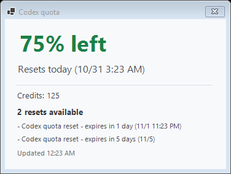

# CodexTray

A lightweight Windows 11 tray utility for Codex quota, reset times, credits and model-specific limits. Unofficial; not affiliated with or endorsed by OpenAI. [MIT licensed](LICENSE).

Version 1.0.0 targets .NET 10 LTS. See [known limitations and security review](docs/SECURITY_REVIEW.md), including the API allowance estimate and unsigned binary distribution.

## Requirements and launch

For a packaged Windows build, extract the complete ZIP into a stable folder and run `CodexTray.exe`. The self-contained x64 package includes .NET; no SDK or separate runtime install is needed. The executable is unsigned. Source-build instructions follow below.

- Windows 11, x64 for the staged binary.
- Codex Desktop or CLI with App Server support, signed in for live data.
- Source builds: [.NET SDK 10.0.403](https://dotnet.microsoft.com/en-us/download/dotnet/10.0), with servicing roll-forward selected by global.json.
- Framework-dependent binaries: .NET 10 Desktop Runtime 10.0.14 or newer supported patch. Self-contained packages include the runtime.

Double-click start.bat in the repository root. It builds current source before launch; if an older instance locks the output, exit it from the tray menu and retry. It uses the locally staged validation SDK if present, otherwise the installed SDK.

```powershell
dotnet restore CodexTray.slnx --locked-mode
dotnet build CodexTray.slnx -c Release --no-restore
dotnet test tests/CodexTray.Tests/CodexTray.Tests.csproj -c Release --no-build --no-restore
.\src\CodexTray\bin\Release\net10.0-windows\CodexTray.exe
```

Only one instance can use the same Windows user's saved data, including across Windows sessions. A second launch in the same session opens the quota window; an instance in another session is refused. Close older copies before upgrading. Windows may hide the icon in the overflow menu; drag it onto the visible tray if desired.

## Display and notifications



Example values only; this image contains no live account data.

The tray icon fills in proportion to included quota remaining, prints the percentage, and uses green/yellow/red usage thresholds. Hover text is X% remaining -- resets in X days. Left-click opens the content-sized quota window; right-click provides Refresh now, Usage Dashboard, Start with Windows, About and Exit.

The main window shows percentage left, reset date in M/d, compact additional-quota rows, credits rounded upward, and available banked resets. Quota resets and banked expirations today or tomorrow include your Windows local time. Calendar-day countdowns are not rolling 24-hour durations. Closing the window hides it; Exit stops the app.

New banked credits and qualifying quota rebounds produce app-owned topmost cards. Cards remain pending until Dismiss, Escape or close and survive restart in encrypted local storage. Long text can scroll; up to 32 cards are retained, with overflow summarized. Cards arrive without stealing focus. Usage threshold alerts remain Windows balloon tips.

The first verified account observation baselines silently. Subsequent observations compare against saved baselines. Account changes clear previous-account trackers and cards; disconnected/signed-out cards stay hidden until identity is verified. If App Server does not expose usable account identity, quota displays but alerts are disabled.

A quota rebound does not prove a banked reset was consumed: scheduled resets and corrections can do the same. The detector requires a 15-point increase, a qualifying armed near-full rebound, or near-full increase with an advanced reset timestamp. A decrease in banked count alone never triggers. See [exact rules and limits](docs/ARCHITECTURE.md).

## Codex discovery

CodexTray checks:

1. CODEXTRAY_CODEX_PATH, when set: must be an existing absolute .exe path. Invalid explicit overrides fail closed.
2. The newest modified codex.exe beneath %LOCALAPPDATA%\OpenAI\Codex\bin.
3. codex.exe in absolute PATH directories.

Use only trusted installations; discovery does not verify code signatures. It does not scan WindowsApps directly or hardcode a Codex version.

```powershell
$env:CODEXTRAY_CODEX_PATH = 'C:\path\to\codex.exe'
.\src\CodexTray\bin\Release\net10.0-windows\CodexTray.exe
```

## Read-only integration

The app uses [official Codex App Server](https://learn.chatgpt.com/docs/app-server) JSONL stdio. It initializes the child, reads account identity with refreshToken=false, reads account/rateLimits/read every 60 seconds, and accepts account/rate-limit notifications. Account identity is checked before and after quota reads to reject stale cross-account responses.

Failed/oversized streams, EOF, timed-out requests and child exit reconnect with bounded backoff. Request deadlines include writes. Shutdown closes stdin and may force-stop only the owned child process tree if it does not exit promptly.

The Codex connection reads no auth.json, cookies or tokens. No private usage endpoint, application HTTP listener, telemetry transport, reset consumption, purchases or login/logout actions exist. Optional API billing uses the Admin key you enter locally for read-only HTTPS Costs API requests.

## Local data

Optional [Pro API allowance monitoring](docs/API_BILLING.md) uses a locally entered Admin key and confirmed grant details. Open Pro API credit setup from the tray menu for estimated dollars/percent remaining, persistent low-balance warnings and a configured renewal time. The API estimate is separate from the Codex tray gauge.

The API meter cannot fetch the actual credit-grant balance or verify renewal/expiry timestamps. It subtracts reported organization spending from your confirmed allowance. An Admin key has broad organization privileges, even though this app uses it only for read-only Costs requests; the feature is optional.

%LOCALAPPDATA%\CodexTray contains encrypted notifications.dat and bounded diagnostic logs. Saved state includes a hashed account fingerprint, minimal baselines and pending notification text. Windows DPAPI protects it for the current Windows user, not from other programs running as that user. Raw identity and unrestricted protocol responses are not persisted. Logs can still contain installation paths; review before sharing.

Start with Windows changes only HKCU\Software\Microsoft\Windows\CurrentVersion\Run\CodexTray. Move the app only after disabling startup, then re-enable from the new location. See [privacy](PRIVACY.md) and [troubleshooting/uninstall](docs/TROUBLESHOOTING.md).

## Local packaging

```powershell
dotnet publish src/CodexTray/CodexTray.csproj -c Release -r win-x64 --self-contained true -p:PublishSingleFile=true -p:IncludeNativeLibrariesForSelfExtract=true -p:RestoreLockedMode=true --output artifacts/publish
```

This creates a local self-contained Windows x64 build, not an upload. Bundled runtimes require rebuilding for security updates. Include LICENSE with distributions. No Authenticode signature is provided.

Run `./scripts/New-ReleasePackage.ps1` after publishing to create a ZIP with runtime license notices and SHA-256 checksums. Use a fresh output folder for each package. Self-contained packages need no separate .NET installation; source builds require the SDK above.

The public repository starts from reviewed source with clean history. Export tooling accepts only deliberately tracked/staged paths and rejects credential/build paths. Do not push an older private development history into the public repository.

## Documentation

- [Security policy](SECURITY.md) and [security review](docs/SECURITY_REVIEW.md)
- [Privacy](PRIVACY.md), [architecture](docs/ARCHITECTURE.md), [troubleshooting](docs/TROUBLESHOOTING.md)
- [Contributing](CONTRIBUTING.md), [release checklist](docs/RELEASING.md)
- [Changelog](CHANGELOG.md), [verification record](SMOKE_TEST_REPORT.md)
- [Public publication handoff](docs/PUBLISHING.md) and [threat model](docs/THREAT_MODEL.md)

## Optional live diagnostic

```powershell
dotnet run --project tools/CodexTray.LiveSmoke/CodexTray.LiveSmoke.csproj -c Release
```

LiveSmoke prints actual usage, reset metadata and the resolved executable path. Its output is private: review and redact before sharing. Synthetic tests do not require credentials; public CI must not run LiveSmoke or consume real resets.
